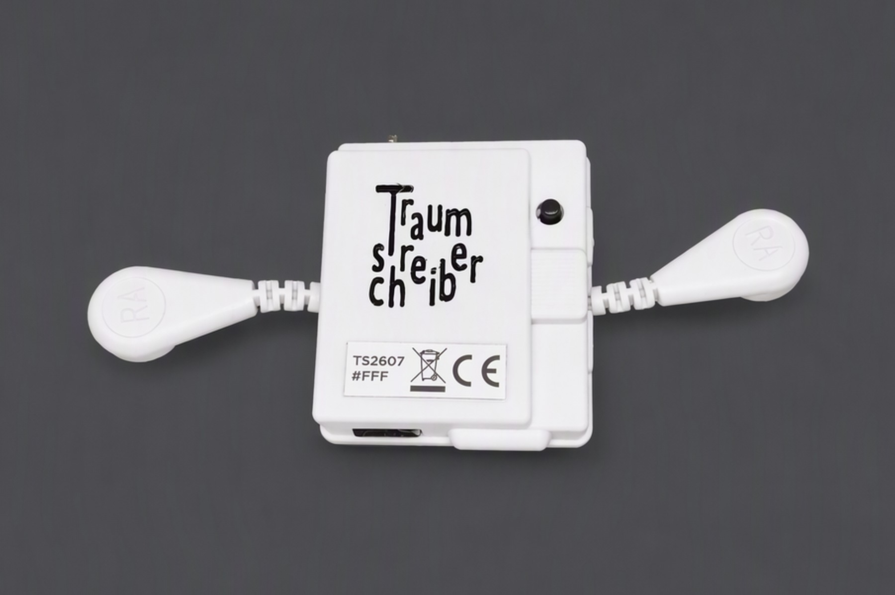
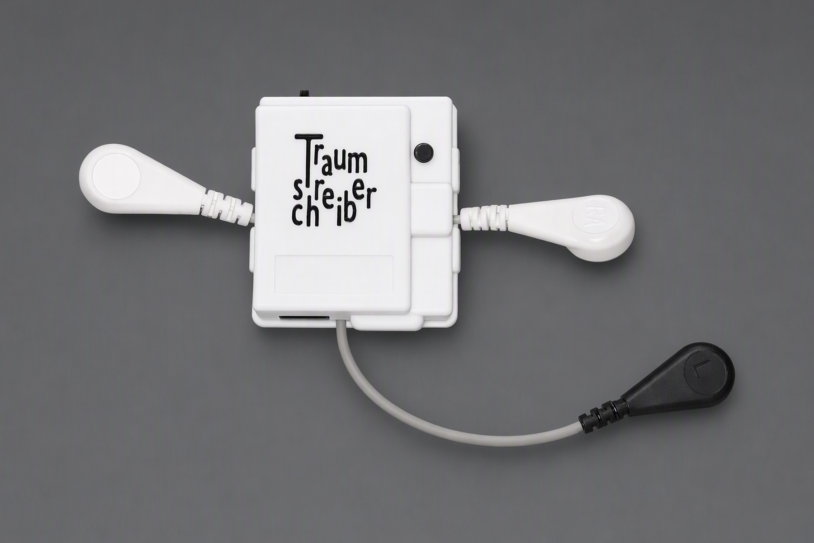
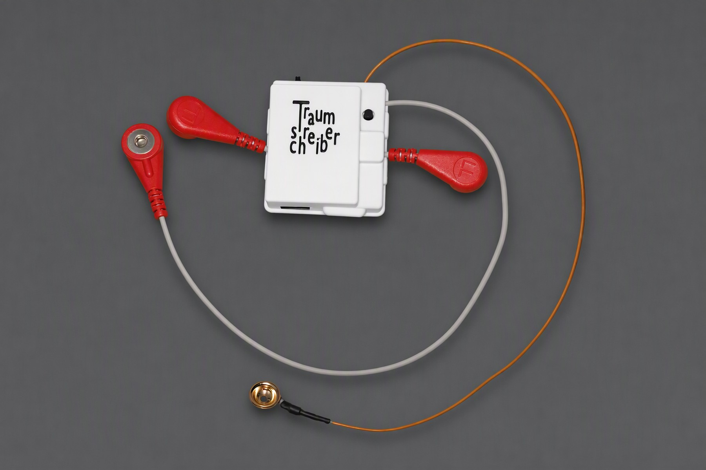
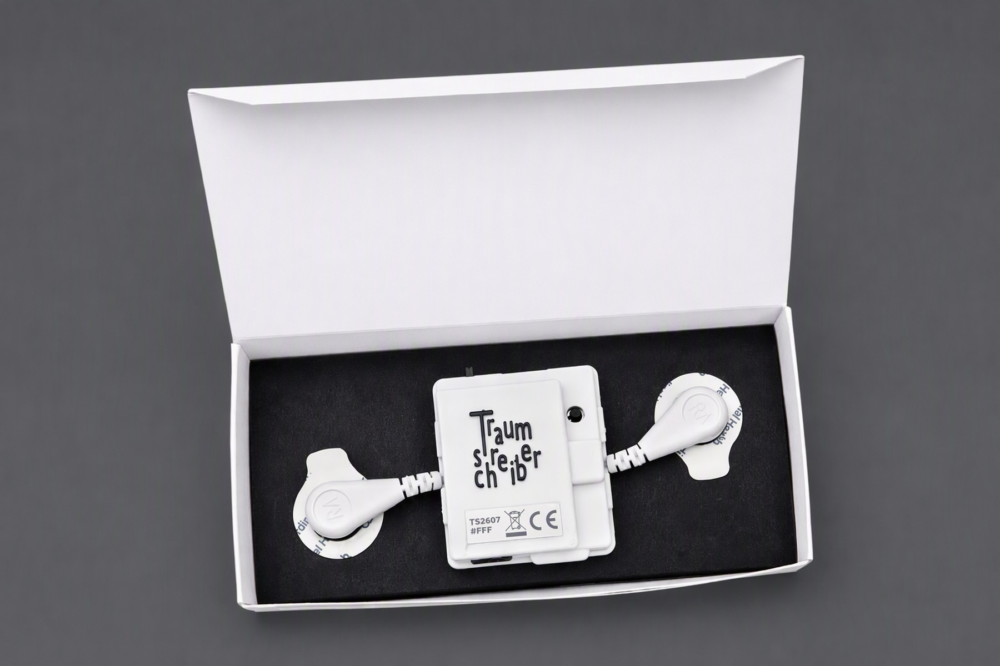
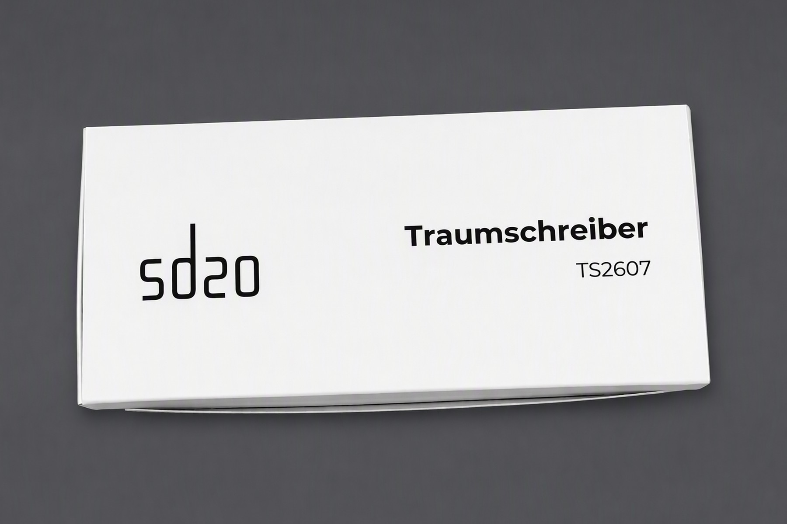
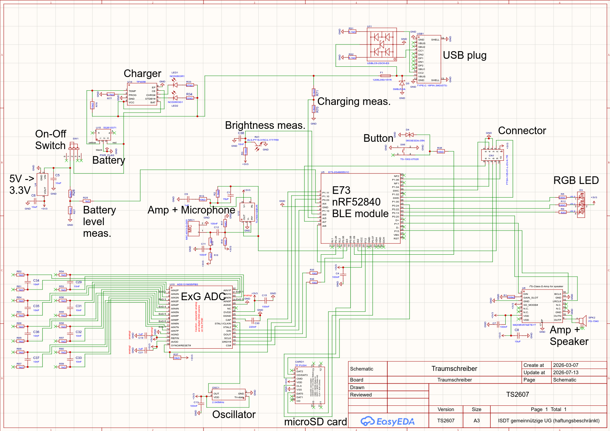

# Traumschreiber

**An open, non-profit forehead EEG for sleep and dream research — made in Hamburg.**

The Traumschreiber ("dream writer") is a small device you wear on your forehead while you sleep.
Through two or more adhesive electrodes it records the tiny electrical signals of your brain (EEG),
your eye movements (EOG) and your muscles (EMG), all night long. The recording is stored on a
microSD card inside the device and can be streamed to your phone via Bluetooth at the same time.

With it you can see your own sleep stages, find out when you were dreaming (REM sleep shows up as
rapid eye movements), run experiments on lucid dreaming, or use the device in a classroom to show
how the brain works. The raw data always belongs to you: no account, no cloud, no subscription,
no hidden fees.

The Traumschreiber is developed by the **Institute of Sleep and Dream Technologies (ISDT)**, part of
the non-profit organization [sd20](https://sd20.org) (ISDT gemeinnützige UG (haftungsbeschränkt),
Hamburg, Germany). It is intended for **education, research, citizen science and
self-observation**. It is **not a medical device** and must not be used to diagnose, monitor or
treat any disease.

## History

The Traumschreiber started in 2016 as a sleep mask with LEDs, sound and Bluetooth, presented
publicly at the [MRMCD 2016](https://media.ccc.de/v/MRMCD16-7762-traumschreiber) in Darmstadt.
It became the subject of a doctoral thesis at the University of Osnabrück
([*The Traumschreiber System*, 2018](https://osnadocs.ub.uni-osnabrueck.de/handle/urn:nbn:de:gbv:700-20181116815))
and was later used as a wearable research platform in
[citizen neuroscience](https://doi.org/10.1111/ejn.16227) (European Journal of Neuroscience, 2024).
Since 2026 it has been redesigned as a compact forehead device that anyone can use at home:
revision TS2603 (March 2026) was followed by **TS2607** (July 2026), the version shown here,
which carries the CE marking.

A comparison of the Traumschreiber with polysomnography (PSG), the gold standard of the sleep lab, using
whole-night recordings from more than 10 participants, is currently under way and is expected to be completed
by the end of 2026. The first results look promising.

## Open hardware, non-commercial on purpose

The Traumschreiber is open hardware in one specific sense: **everyone who uses it should be able to
see, 100 %, how their data comes about.** Which electrode is connected to which amplifier input,
how the signal is filtered, sampled and stored, what the firmware and the app do with it, and
exactly which values end up in the raw data you can access. The aim is that nothing is hidden behind
a black box. This repository starts with the complete schematic; firmware and analysis code are to
follow.

This transparency is what makes the device useful for its two main purposes: **education** (also
teaching yourself how sleep, dreams and the brain work) and **research**, where results are only
worth something if the measurement can be traced back and checked.

We deliberately offer the Traumschreiber **non-commercially**, through a non-profit organization.
That is why we chose a **non-commercial license** (CC BY-NC-SA 4.0): you are free to study, rebuild
and improve it for education, research and personal use, but not to sell it or build a business on
our work without talking to us first. Note that this differs from the "Open Source Hardware"
definition of the OSHWA, which also allows commercial use; we think the non-commercial license fits
our mission better.

**If you think this approach is worth supporting, we are very happy about a donation:**
[PayPal](https://www.paypal.com/donate/?hosted_button_id=E25FNKM9Q8RXQ), or ask for our bank
details at [donation@sd20.org](mailto:donation@sd20.org). ISDT gemeinnützige UG is a recognized
non-profit in Germany.

## Photos

| | |
|---|---|
|  |  |
| Three snap electrodes | Three snap electrodes + one gold-cup electrode |
|  |  |
| Delivered in its box, ready to use | Packaging |

More: [`photos/`](photos/)

## Technical details

| | |
|---|---|
| **Model** | Traumschreiber TS2607 |
| **Biosignals** | EEG, EOG, EMG, ECG (depending on electrode placement) |
| **Analog front end** | Texas Instruments ADS131M08: 8 differential channels, 24 bit, sampled simultaneously |
| **Sampling rate** | 250 samples/s per channel |
| **Gain** | programmable 1–128, globally or per channel (default 4, input range ±300 mV) |
| **Electrodes** | standard: 2 snap electrodes (one channel); other configurations up to 6 snap + 3 gold-cup electrodes on request |
| **Microcontroller** | Nordic nRF52840 |
| **Storage** | microSD card (16 GB included), recordings as BDF files |
| **Further sensors** | microphone with preamplifier, ambient light sensor, button, battery voltage |
| **Outputs** | RGB LED, speaker (I²S class-D amplifier) for light and sound cues |
| **Battery** | Li-Po 3.7 V / 560 mAh, user-replaceable without tools |
| **Charging** | USB-C, 5 V ⎓ 0.3 A |
| **Housing** | 3D-printed PETG, approx. 55 × 45 × 17 mm |
| **Weight** | approx. 41 g including battery and electrode leads |
| **Firmware** | Zephyr RTOS / nRF Connect SDK, updatable over the air |
| **App** | [sd20 App](https://play.google.com/store/apps/details?id=org.sd20.sd20app) for Android (recording, sleep and dream diary). **Note:** a major app update is coming at the end of October 2026; until then we strongly recommend installing the [Nightly version](https://sd20.org/isdt/en/projects/sd20/). |

## Hardware

The complete circuit is published as a schematic, so you can follow exactly which component is
connected to which:

- [`hardware/TS2607_schematic.pdf`](hardware/TS2607_schematic.pdf) — vector PDF, zoomable; every
  part value and net is readable
- [`hardware/TS2607_schematic.png`](hardware/TS2607_schematic.png) — overview image

Main blocks: ExG ADC (ADS131M08) with input filters · nRF52840 BLE module · microSD card ·
microphone with TLV9001 preamplifier · MAX98357A amplifier and speaker · RGB LED · ambient
light sensor · TP4056 charger, battery and on/off switch · 3.3 V regulator · USB-C with ESD
protection.

Layout files (Gerber), bill of materials and production data are not part of this repository.
If you want to build on the Traumschreiber, collaborate with us or have any questions, please
get in touch (see below).

## Community projects

Software that works with the Traumschreiber. Built something yourself? Tell us at
[ts-repo@sd20.org](mailto:ts-repo@sd20.org) and we add it here.

| Project | What it does |
|---|---|
| [sd20 App](https://play.google.com/store/apps/details?id=org.sd20.sd20app) | Android app for overnight recordings with the Traumschreiber, sleep and dream diary, and "Cook", an AI assistant with recipes for falling asleep and waking up. **Note:** a major app update is coming at the end of October 2026; until then we strongly recommend installing the [Nightly version](https://sd20.org/isdt/en/projects/sd20/). |
| Traumschreiber Mindreading (repository coming soon) | Android app that guesses which of four colours you are thinking of, from your brain's P300 response. For the 3 snap + 1 gold-cup configuration. |
| Traumschreiber BLE live plot (repository coming soon) | A single Python script that reads the Bluetooth data stream and plots all 8 channels in real time, e.g. for signal checks with a function generator. |

## Get a Traumschreiber

The Traumschreiber is produced in small batches in Hamburg.
Information, prices and orders: **<https://sd20.org/traumschreiber/en/>** (German: <https://sd20.org/traumschreiber/>).
Accessories such as snap electrodes and electrode leads: [sd20 Factory](https://sd20.org/fabrik/en/).

## Contact and collaboration

Want to use the Traumschreiber in your research or teaching, collaborate on hardware, firmware or
analysis, or just have a question? Write to us: **[ts-repo@sd20.org](mailto:ts-repo@sd20.org)**

We are very happy about **pull requests, issues and suggestions**, here and in the
firmware and community repositories (coming soon). We review
every contribution and gladly include it in the next official release after testing.

## License

The contents of this repository (schematic, photos and documentation) are licensed under
[Creative Commons Attribution-NonCommercial-ShareAlike 4.0 International (CC BY-NC-SA 4.0)](LICENSE).

You may study, share and adapt the design for **non-commercial** purposes (see
[Open hardware, non-commercial on purpose](#open-hardware-non-commercial-on-purpose)), as long as you give
credit ("Traumschreiber by ISDT gemeinnützige UG / sd20.org") and share your changes under the same
license. For commercial use, please contact us at [ts-repo@sd20.org](mailto:ts-repo@sd20.org).

"Traumschreiber" and "sd20" are names of ISDT gemeinnützige UG (haftungsbeschränkt); the license
does not grant any rights to these names or logos. A device you build yourself from this
schematic is not covered by our CE declaration.
